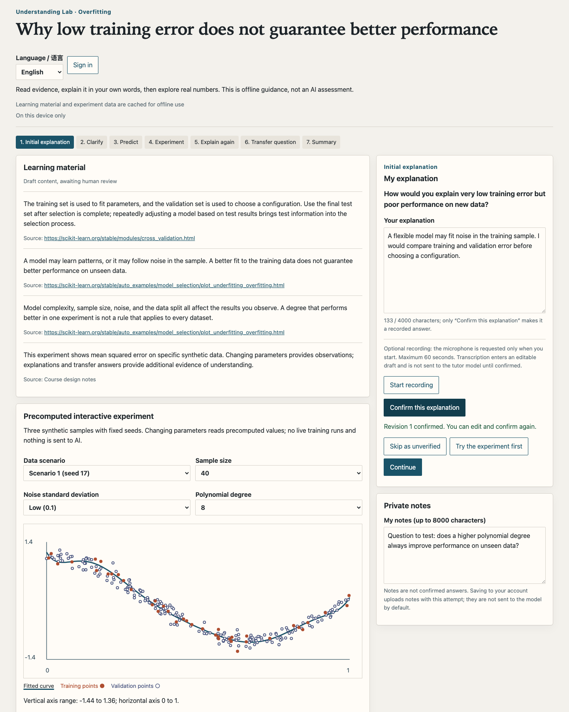
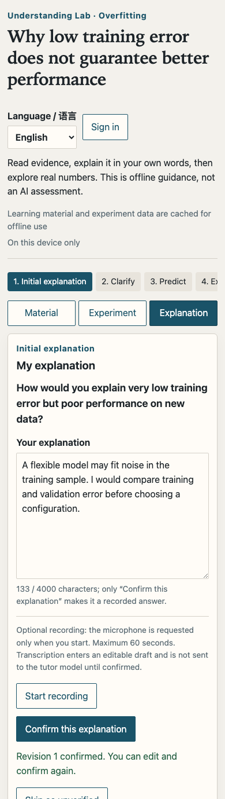
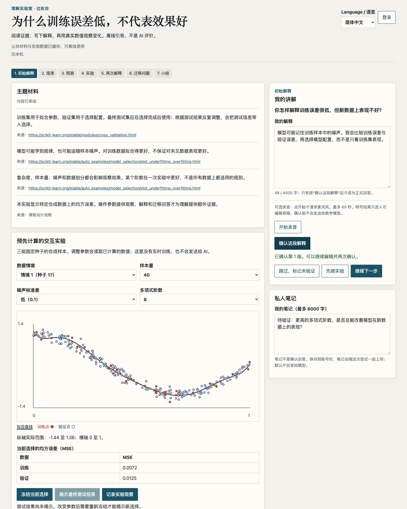

<h1 align="center">Understanding Lab</h1>

<p align="center"><strong>Explain it. Test it. Understand it.</strong></p>
<p align="center">English · <a href="README.zh-CN.md">简体中文</a></p>

<p align="center">
  <a href="https://github.com/tsumon/understanding-lab/actions/workflows/ci.yml?query=branch%3Acodex%2Funderstanding-lab-mvp"></a>
  <a href="LICENSE"></a>
</p>

Understanding Lab is a local-first, bilingual AI course with 12 interactive chapters: data splits, regression, overfitting, optimization, classification, neural networks, embeddings, attention, generation, retrieval, evaluation, and responsible deployment. Predict, explore a deterministic experiment, explain a transfer case, and reflect. Course progress stays in this browser. The original overfitting learning loop remains available separately.

## See the app

<p align="center"><a href="assets/readme/desktop-en.png"></a></p>

<p align="center">
  <a href="assets/readme/mobile-en.png"></a>
  &nbsp;&nbsp;
  <a href="assets/readme/desktop-zh-CN.png"></a>
</p>

These screenshots show the retained original overfitting lesson, not the new course catalog. Examples are synthetic, not model-generated teaching feedback.

## What you can do

- **Learn locally:** keep drafts and notes in your browser; cache the built app for offline use.
- **Switch languages:** use English or 简体中文 without rewriting your answers, notes, experiments, or historical feedback. Your preference stays in this browser.
- **Follow a complete course:** explore 12 chapters in either language, with predictions, distinct experiment comparisons, knowledge checks, self-review rubrics, and reflections. Suggested time totals about 7 hours; this is an editorial estimate, not measured learner performance.
- **Explore the original overfitting lab:** compare curves and training/validation error across 324 precomputed configurations, then freeze a choice before revealing test error.
- **Stay in control:** export course progress and confirm before resetting it. Optional account saving, tutor feedback, and voice transcription apply to the retained original lesson, with separate consent when configured.

## How a lesson works

**New course:** read → predict → experiment → transfer → check and revise → reflect. Prerequisites are suggestions, not locks. Completion records practice evidence and corrected checks, not certified mastery. Transfer/reflection length checks do not grade reasoning; use the provided rubric. No AI service is called by the course.

**Original overfitting lesson:** **Explain → predict → experiment → re-explain → transfer → reflect.** You can skip prompts and return to earlier answers. In the overfitting experiment, choose a model before revealing held-out test error. Changing the setup after reveal marks the test result as contaminated. The experiment catalog contains 324 reproducible configurations; its numeric outcomes are generated data, not a claim about every real dataset.

Learning works without an account or AI provider. Sending an answer to the optional tutor and saving an attempt to an account are separate actions with separate consent. Voice transcription is optional too: recording does not send audio until you explicitly request transcription. Tutor and transcription are disabled by default. Enabling the tutor can make a potentially billable provider probe at every server start. Configuration steps are in the [getting started guide](docs/getting-started.md).

## Run locally

Requires Node.js 22.12 or newer and npm. Node 22.23.2 / npm 10.9.8 were used for the verified setup. `better-sqlite3` includes a native module; on platforms without a matching prebuilt binary, installation may require local build tools.

```sh
git clone --branch codex/understanding-lab-mvp https://github.com/tsumon/understanding-lab.git
cd understanding-lab
npm ci
npm run dev
```

Open the local URL printed by Vite: `/` opens the course catalog, `/#course/<chapter-id>` a chapter, and `/#legacy` the original lesson. No `.env`, account, model key, or backend server is needed for local course study. For offline use and optional account, tutor, and transcription services, follow [Getting started](docs/getting-started.md). The deeper [deployment guide](docs/deployment.md) is in Chinese.

For offline use, run `npm run build:offline` and `npm run preview:offline`, visit the printed URL online once, and wait for the cache-ready status before going offline. External source links still need a connection. Course records are separate from original lesson drafts; browser storage is not a durable backup.

## Project checks

```sh
npm run typecheck
npm test
npm run experiment:test
npm run build:offline
```

The experiment checks also require `uv` and Python 3.12.13; see [Contributing](CONTRIBUTING.md) for setup and browser checks. CI uses deterministic fixtures, not paid model calls.

## Current scope

Twelve bilingual chapters plus the retained original overfitting lesson, delivered as a responsive web app; no hosted service or native app package. Course experiments use synthetic data, fixed examples and explicitly stated simplifications—not production model evaluations. Real-model teaching quality, human review (including the English translation), real OAuth, and physical-device voice acceptance are still pending. An intermittent WebKit draft/summary regression remains open. Engineering checks are not proof of learning outcomes.

## Documentation

- [Course plan](docs/course-plan.md) and [platform/storage boundaries](docs/course-platform.md)
- [Getting started](docs/getting-started.md): local setup and optional services
- [Contributing](CONTRIBUTING.md): changes, checks, and data handling
- [Deployment](docs/deployment.md) and [privacy boundaries](docs/privacy.md) (Chinese)
- [License](LICENSE) and [third-party notices](THIRD_PARTY_NOTICES.md)

## License

Original project source and documentation are offered under the [MIT License](LICENSE), subject to the separate terms of dependencies and other materials described in [THIRD_PARTY_NOTICES.md](THIRD_PARTY_NOTICES.md).
